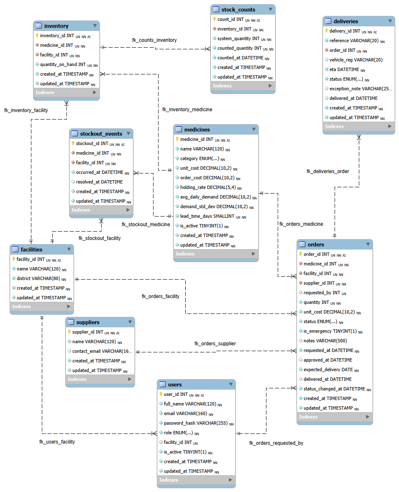

# BFB321 Group 4 Semester Project - MedSync Supply Chain Web Application

## Project Description
Digitizing Medicine Supply Chains to Reduce Stockouts in South African Public Healthcare. This application helps medical facilities calculate and track inventory metrics including Economic Order Quantity (EOQ), Safety Stock (SS), and Reorder Points (ROP) to streamline medical supplies management.

## Group Members, Student Numbers and GitHub Accounts
**Group 4** | BFB321 Supply Chain Digital Technology | Project: **MedSync: Digitising Medicine Supply Chains to Reduce Stockouts in South African Public Healthcare**

| Student Name | Student Number | GitHub Username |
| :--- | :--- | :--- |
| Meagan Staples | u24645177 | u24645177 |
| Despina Papageorgiou | u24627527 | Despina-papag |
| Callum Kenyon-Slade | u24721787 | CallumKenyon-Slade |

Repository: https://github.com/u24645177/BFB321_Group4_Project

## Task Allocation

| Member | Role | Work done (see the commit history and merged pull requests) |
| :--- | :--- | :--- |
| Despina Papageorgiou | Database and backend | MySQL schema and seed data, `db.py` (parameterised queries, transactions with rollback), REST API endpoints in `routes/api.py`, pagination, filtering and validation, live KPI calculations |
| Meagan Staples | Frontend integration and video | Blueprint structure, reusable fetch helper, the three end-to-end flows, confirmation messages, loading/empty/error states, live KPI cards and charts, endpoint documentation, screenshots, Part B video |
| Callum Kenyon-Slade | Report, configuration and testing | `.gitignore`, `.env.example`, `requirements.txt`, `config.py`, `logging_setup.py`, `errors.py`, application wiring in `app.py`, ERD, automated tests, backup/restore/rollback notes, setup runbook, Part C report |

## Setup & Installation Instructions

### Prerequisites
- Python 3.10+
- MySQL 8.0 (Server and command-line client)
- Git

### Installation Steps
1. Clone the repository:
   ```
   git clone https://github.com/u24645177/BFB321_Group4_Project.git
   cd BFB321_Group4_Project
   ```

2. Set up a virtual environment:
   - Windows:
     ```
     python -m venv venv
     venv\Scripts\activate
     ```
   - Mac/Linux:
     ```
     python3 -m venv venv
     source venv/bin/activate
     ```

   On Windows PowerShell, if activation fails with "running scripts is disabled", run this once in the same window and activate again:
   ```
   Set-ExecutionPolicy -Scope Process -ExecutionPolicy RemoteSigned
   ```

3. Install dependencies:
   ```
   pip install -r requirements.txt
   ```

4. Create your settings file from the template, then open `.env` and fill in your MySQL user and password:
   - Windows: `copy .env.example .env`
   - Mac/Linux: `cp .env.example .env`

   In `.env`, set `MYSQL_USER` and `MYSQL_PASSWORD` to the project user you create in Database Setup below, and set `SECRET_KEY` to any long random string. A suitable one can be generated with:
   ```
   python -c "import secrets; print(secrets.token_hex(32))"
   ```

5. Create the database and load the demo data (see [Database Setup](#database-setup) below).

6. Run the application:
   ```
   python app.py
   ```
   Then open http://localhost:5001 in your web browser.

7. Run the test suite:
   ```
   python -m pytest tests/
   ```

## Database Setup

MedSync uses **MySQL 8.0**. `database/schema.sql` creates the `medsync` database and its tables; `database/seed.sql` fills every table with demo data.

1. Log in to MySQL as root (Windows: the full path is usually `"C:\Program Files\MySQL\MySQL Server 8.0\bin\mysql.exe"`):

   You will be asked for the root password, the one you chose when you installed MySQL. It is not the project password you create in the next step.
   ```
   mysql -u root -p
   ```

2. Create a project user with access to the `medsync` database only, using the same user and password you put in `.env`:
   ```sql
   CREATE USER 'medsync_app'@'localhost' IDENTIFIED BY 'choose-a-password';
   GRANT ALL PRIVILEGES ON medsync.* TO 'medsync_app'@'localhost';
   FLUSH PRIVILEGES;
   ```
   Replace choose-a-password with a password of your own, and use the same password for MYSQL_PASSWORD in .env. If MySQL says the user already exists, reset it with ALTER USER 'medsync_app'@'localhost' IDENTIFIED BY 'your-password'; and then run the GRANT and FLUSH PRIVILEGES lines again.

3. From the project root, build the tables and load the demo data:
   ```sql
   source database/schema.sql
   source database/seed.sql
   exit
   ```
   Run the same two `source` commands again at any time to reset the demo data.

### Demo data and sign-in
The prototype has no sign-in screen: open http://localhost:5001 directly. The seed data includes 8 medicines, 3 Tshwane hospitals, 4 suppliers, 24 orders and 60 days of delivery, stockout and stock-count history, with dates relative to today so the KPIs always look current. Three users are seeded for the planned role-based sign-in (password `MedSync2026!`, stored only as a hash): `admin@medsync.test`, `procurement@medsync.test` and `pharmacist@medsync.test`.

## Database Schema and ERD



Nine tables, normalised to 3NF, with primary and foreign keys, `CHECK` constraints, `DECIMAL` money fields and `created_at`/`updated_at` audit fields:

| Table | Holds |
| :--- | :--- |
| `medicines` | The catalogue, with the EOQ inputs: unit cost, order cost, holding rate, average daily demand, demand standard deviation, lead time |
| `facilities` | Hospitals that hold stock |
| `inventory` | Stock on hand of each medicine at each facility (link table between medicines and facilities) |
| `suppliers` | Pharmaceutical suppliers |
| `orders` | Reorder requests and their status (Awaiting Approval → Approved → Ordered → In Transit → Delivered, or Delayed) |
| `deliveries` | The delivery for each placed order, with ETA, vehicle and exception notes |
| `users` | Staff accounts with a role (admin, procurement officer, pharmacist) |
| `stockout_events` | When a medicine ran out at a facility and when it was restocked |
| `stock_counts` | Physical counts compared with the system quantity |

## Project Structure

```
app.py                 Creates the Flask app and registers the blueprints
config.py              Development, testing and production settings (APP_ENV)
db.py                  MySQL connection per request, parameterised queries, transactions with rollback
errors.py              JSON error responses for the API, friendly error pages for the site
logging_setup.py       Logging to the console and logs/medsync.log
requirements.txt       Python dependencies (pinned versions)
.env.example           Template for the .env settings file (copy to .env; never commit .env)
routes/pages.py        pages_bp: HTML pages (/, /reorder, /tracking, /kpis)
routes/api.py          api_bp: JSON endpoints under /api
data/dashboard.py      Medicines, orders, KPIs and alerts (SQL queries and validation)
data/deliveries.py     Deliveries and facilities (SQL queries and validation)
models/eoq.py          EOQ, safety stock and reorder point
database/              schema.sql and seed.sql
templates/, static/    HTML templates, CSS and JavaScript
tests/                 pytest tests (EOQ, validation, API)
docs/erd.png           Entity relationship diagram (editable source: docs/medsync.mwb)
docs/backup-restore.md Backup, restore and rollback notes
```

### Configuration
Settings come from `.env` (see `.env.example`); nothing secret is stored in the code. `APP_ENV` chooses the settings in `config.py`: `development` (default, debug on), `testing` or `production` (requires `SECRET_KEY`).

## Logging and Error Handling
`logging_setup.py` writes levelled messages (time, level, module, text) to the console and to `logs/medsync.log` (rotating, three backups of 1 MB). Every error is caught centrally in `errors.py`: API URLs get a JSON `{"error": "..."}` response and pages get a short friendly error page. Stack traces are logged but never shown to the user. Failed database writes are rolled back by `transaction()` in `db.py`.

## Testing
```
python -m pytest tests/
```
96 automated tests cover the EOQ, safety stock and reorder point calculations (`test_eoq.py`), input validation and the stock status rule (`test_validation.py`) and API routing, error responses and request validation (`test_api.py`). None of them needs MySQL to be running.

## Backup, Restore and Rollback
Full instructions, with commands for Windows PowerShell, are in [docs/backup-restore.md](docs/backup-restore.md). In short:

- **Back up:** `mysqldump -u root -p --single-transaction --routines --result-file="backups\medsync_YYYY-MM-DD.sql" medsync`
- **Restore:** `cmd /c "mysql -u root -p medsync < backups\medsync_YYYY-MM-DD.sql"`
- **Reset to demo data:** run `database/schema.sql` then `database/seed.sql` (this deletes current data).
- **Rollback:** failed writes roll back automatically; for a bad manual change, restore the latest backup.

Backups are kept out of Git (`backups/` is in `.gitignore`).


## API Endpoints

All endpoints return JSON. Lists use `{"data": [...], "page": 1, "size": 10, "total": 23}`; single records use `{"data": {...}}`. Errors return `{"error": "message"}`, plus `"fields": {"field": "message"}` for invalid input.

| Method | Path | Purpose | Success | Errors |
| :--- | :--- | :--- | :--- | :--- |
| GET | `/api/health` | Check the API is running | 200 | |
| GET | `/api/medicines` | List medicines with stock status. Query: `category`, `status` (Critical, Low, Sufficient), `page`, `size` | 200 | 400 |
| GET | `/api/medicines/<id>` | One medicine | 200 | 404 |
| POST | `/api/medicines` | Add a medicine (Flow 1) | 201 | 400, 409 |
| PATCH | `/api/medicines/<id>` | Update stock count, demand, lead time or costs | 200 | 400, 404 |
| GET | `/api/medicines/<id>/reorder` | EOQ order recommendation with reorder point | 200 | 404 |
| GET | `/api/eoq?medicine=<name>` | The same recommendation by medicine name (used by the reorder form) | 200 | 400, 404 |
| GET | `/api/requests` | List reorder requests, newest first. Query: `status`, `page`, `size` | 200 | 400 |
| GET | `/api/requests/<id>` | One reorder request | 200 | 404 |
| POST | `/api/requests` | Create a reorder request (Flow 2) | 201 | 400 |
| PATCH | `/api/requests/<id>/status` | Move a request to its next status; Delivered adds the stock | 200 | 404, 409 |
| GET | `/api/deliveries` | All deliveries with the board summary | 200 | |
| GET | `/api/deliveries/<id>` | One delivery, e.g. `DEL-1042` | 200 | 404 |
| PATCH | `/api/deliveries/<id>` | Update a delivery's status or exception (Flow 3) | 200 | 400, 404 |
| GET | `/api/kpis` | The seven KPIs and live stock metrics. Query: `category` | 200 | |

### Request and response examples

**POST `/api/medicines`** (`unit_cost` and `order_cost` are optional)
```json
{"name": "Aspirin 300mg", "category": "analgesics", "current_stock": 120,
 "avg_daily_demand": 8, "demand_std_dev": 2, "lead_time_days": 7, "unit_cost": 15.50}
```
201 response:
```json
{"data": {"name": "Aspirin 300mg", "category": "analgesics", "current_stock": 120,
          "reorder_point": 65, "safety_stock": 9, "status": "Sufficient"}}
```

**PATCH `/api/medicines/<id>`** (send any of `current_stock`, `avg_daily_demand`, `demand_std_dev`, `lead_time_days`, `unit_cost`, `order_cost`). A new `current_stock` is recorded as a physical stock count, which updates the record accuracy KPI; stock reaching 0 is logged as a stockout.
```json
{"current_stock": 150}
```
200 response: the medicine, with its recalculated reorder point and status.

**GET `/api/medicines/<id>/reorder`** 200 response:
```json
{"data": {"medicine": "Ibuprofen 400mg", "recommended_quantity": 833, "annual_demand": 3650,
          "order_cost": 350.0, "holding_cost": 3.68, "current_stock": 9,
          "reorder_point": 83, "status": "Critical"}}
```

**POST `/api/requests`** (`priority` is `Standard` or `Emergency`)
```json
{"medicine": "Ibuprofen 400mg", "quantity": 833, "supplier": "MediSupply SA",
 "expected_delivery": "2026-12-15", "priority": "Emergency", "notes": "Below safety stock"}
```
201 response: `{"data": {"id", "medicine", "quantity", "supplier", "status": "Awaiting Approval", ...}}`

**PATCH `/api/requests/<id>/status`** (no body) 200 response:
```json
{"data": {"request": {"id": 1, "status": "Approved", "next_action": "Mark ordered", ...},
          "inventory": {"name": "Ibuprofen 400mg", "current_stock": 9, "status": "Critical", ...}}}
```

**PATCH `/api/deliveries/<id>`** (`status` is Scheduled, In Transit, Delayed, Delivered or Failed; Delayed and Failed need an `exception`)
```json
{"status": "Delayed", "exception": "Vehicle breakdown on N4"}
```
200 response: `{"data": {"delivery": {"id", "route", "vehicle", "eta", "status", "exception"}, "summary": {...}}}`. Marking a delivery Delivered also marks its order Delivered and adds the stock.

**GET `/api/kpis`** 200 response:
```json
{"data": [{"key": "on_time_delivery", "name": "On-time delivery", "value": 86, "previous": 38,
           "target": 95, "unit": "%", "status": "warning", ...}],
 "metrics": [{"key": "stock_value", "name": "Stock value", "value": 58613, "unit": "rand", ...}]}
```
